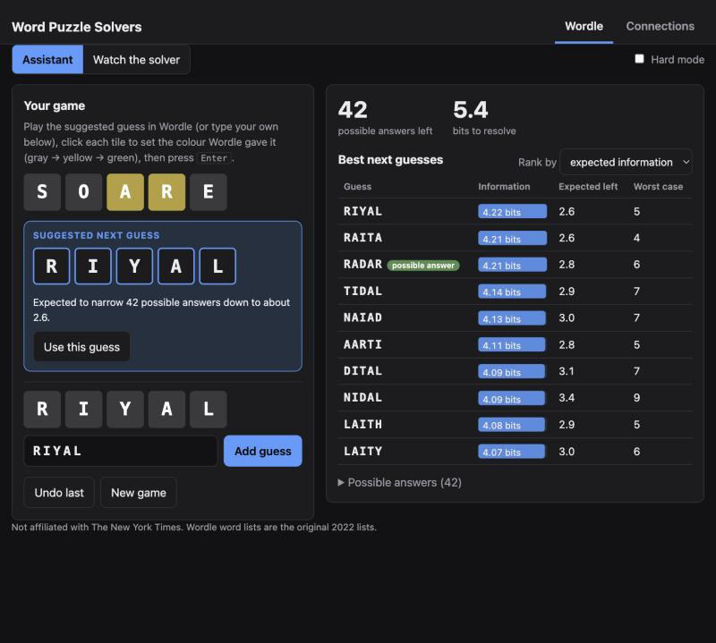
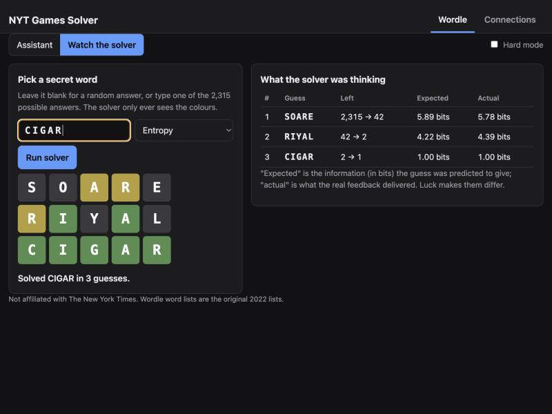
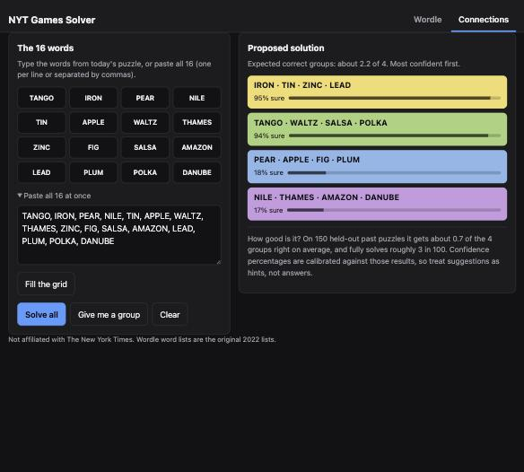
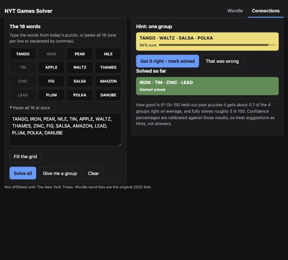
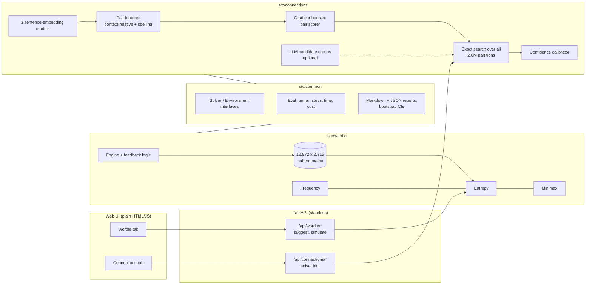

# Word Puzzle Solvers

Solvers for **Wordle** and the **Connections** word-grouping puzzle, a rigorous evaluation harness that benchmarks every
approach, and a web UI with a tab for each game.

**Live demo (Wordle):** https://nyt-games-solver.onrender.com &nbsp;·&nbsp; free hosting, so the first load after a pause takes up to a minute to wake. Connections runs locally (it needs a few GB of RAM; see [Deploy](#deploy)).

| Wordle assistant | Watch the solver |
|---|---|
|  |  |

| Connections: solve all | Connections: one-group hints |
|---|---|
|  |  |

> The Connections puzzle in these screenshots is one I made up for the demo. It is much easier than
> real puzzles; see the results below for honest numbers on real ones.

## Results at a glance

**Wordle** is essentially solved: the entropy solver wins **100%** of all 2,315 original answers
within 6 guesses, averaging **3.464** guesses.

**Connections** is hard, and the solver is modest: on 150 held-out past puzzles it gets
**0.83 of 4 groups** right on average and fully solves **6.0%**. Every number is reported with a
confidence interval, and the test puzzles were scored exactly once (see
[Evaluation methodology](#evaluation-methodology)).

### Wordle (all 2,315 original answers, 12,972 allowed guesses)

| Approach | Win ≤6 | Avg guesses | Worst case | ms / puzzle |
|---|---|---|---|---|
| Letter-frequency baseline | 99.35% | 3.622 | 9 | 0.7 |
| **Entropy (max expected information)** | **100%** | **3.464** | 6 | 18.2 |
| Minimax (minimise worst case) | 100% | 3.514 | **5** | 19.0 |
| Frequency, hard mode | 99.35% | 3.622 | 9 | 0.7 |
| Entropy, hard mode | 99.70% | 3.602 | 8 | 3.9 |
| Minimax, hard mode | 99.48% | 3.651 | 8 | 4.0 |

Games are capped at 12 guesses so averages and worst cases are not truncated; "Win ≤6" is the
official rule. Timing excludes one-time setup (pattern matrix: 1.8 s cold, then cached).
Guess-count histograms are in [`results/wordle.md`](results/wordle.md).

- Hard mode costs the entropy solver about 0.14 guesses and 0.3 points of win rate.
- The frequency baseline is identical in both modes: it only ever guesses remaining candidates,
  and any candidate is already a legal hard-mode guess.
- Minimax gives up 0.05 guesses on average to guarantee no game needs more than 5.

### Connections (150 held-out puzzles, seeded sample of 628 past puzzles)

| Approach | Fully solved | Avg groups (of 4) [95% CI] | Time / puzzle |
|---|---|---|---|
| Random | 0.0% | 0.01 | – |
| Embeddings: MiniLM | 1.3% | 0.39 [0.29, 0.51] | 0.07 s |
| Embeddings: mpnet | 2.7% | 0.59 [0.45, 0.73] | 0.05 s |
| **Learned pair scorer** (3 embedding models + spelling features) | 3.3% | **0.70** [0.55, 0.85] | 0.17 s |
| Local LLM alone (Qwen3-8B, 4-bit) | 2.0% | 0.43 [0.30, 0.57] | 9.7 s |
| Hybrid: LLM candidates + exact search + embeddings | 3.3% | 0.55 [0.41, 0.71] | 25.9 s |
| **Learned scorer + local LLM candidates** | **6.0%** | **0.83** [0.66, 1.01] | 25.9 s |

Paired differences on the same puzzles (95% bootstrap CI): learned + LLM beats plain mpnet by
**+0.24** [+0.11, +0.37]; the learned scorer beats mpnet by **+0.11** [+0.01, +0.22]. The simple
"LLM candidates + embeddings" hybrid is **not** distinguishable from mpnet alone (−0.03 [−0.17,
+0.11]). Full tables, per-tier accuracy and the date split are in
[`results/connections.md`](results/connections.md).

**Not benchmarked:** the Claude (Haiku 5.5 / Sonnet 5.5) solvers are implemented and unit-tested
against a fake client, but I never ran them against the real API (no API credit). I expect a model
of that size to do much better on wordplay, but that is a guess, not a result. The local-model
numbers above are the only LLM numbers in this repo.

## How it works



Both games plug into the same `Solver` / `Environment` interfaces and the same evaluation runner,
so a new game or approach is benchmarked and reported by the same code.

## Design decisions worth discussing

### Wordle

- **Answers vs. allowed guesses.** The 2,315 *answers* are the targets; the 12,972 *allowed
  guesses* are the probe words. A non-answer can split the remaining candidates better than any
  answer can, so the solver probes from the full list but ranks candidates higher on ties (a
  candidate guess also has a chance to win). I use the **original 2022 lists**, the standard in
  the literature; the NYT has since edited both, so there is no single current "official" list.
- **Duplicate-letter feedback** is the classic bug. The rule is two passes: mark greens and remove
  those letters from the pool, then mark a yellow only while an unconsumed copy remains. It is
  tested against hand-derived cases, an independently written reference implementation
  (exhaustively over all pairs of 5-letter words on a 2-letter alphabet, plus 30,000 random pairs
  and 20,000 real-word pairs), and algebraic properties. A naive "yellow if the letter appears
  anywhere" scorer fails 5 of the 7 hand cases.
- **Pattern matrix.** Precomputing all 12,972 × 2,315 feedback codes (base-3, one `uint8` each)
  turns "score this guess against every candidate" into a row slice and one `bincount`, so
  entropy over every possible guess takes milliseconds. A solver turn is dominated by the first
  move, which is cached.
- **Sanity check against the literature.** The best opening by expected information is `SOARE`
  at 5.886 bits, followed by `ROATE` and `RAISE`, matching published values for the original lists.
  Greedy entropy at 3.464 is close to the roughly 3.42 reported for optimal play (I did not verify
  that figure against a source).
- **Hard mode** is enforced by the environment (an illegal guess raises), and a vectorised
  legality mask is tested against the scalar rule on random histories.

### Connections

- **Exact partition search.** There are C(16,4) = 1,820 possible groups and
  16!/(4!⁴·4!) = **2,627,625** partitions. That is small enough to enumerate once, so "search" is a
  single vectorised gather-and-sum and the answer is *exact*, with no heuristic pruning. Constraints
  are free: score a forbidden group `-inf` and no partition containing it can win. That is how the
  hint mode respects groups you already found and guesses you know are wrong.
- **Why summing pair log-odds.** If each of the 120 word pairs were independent with probability
  `p` of sharing a group, the likelihood of a partition is `∏ same p · ∏ different (1−p)`. The
  second factor does not depend on the partition, so the most likely partition maximises the sum
  of `logit(p)` over same-group pairs. The independence assumption is false, but the exact search
  enforces the one global constraint that matters: four groups of four.
- **Relative features.** A cosine similarity means different things in a puzzle of food words and
  a puzzle of verbs, so features are computed per puzzle: raw and mean-centred cosines, z-scores,
  each word's rank among the other 15, and similarity of the two words' similarity profiles.
- **Calibrated confidence.** For each proposed group, a logistic regression on two signals (mean
  pair log-odds, and how much worse the best partition gets if the group is forbidden) is mapped
  to the probability that the group is exactly right. It is fit on out-of-fold dev predictions and
  checked on the held-out puzzles: expected calibration error **0.026**, Brier score **0.116** vs
  0.144 for always predicting the base rate. It is slightly overconfident at the top (72% stated,
  65% actual on 51 groups). See [`results/connections_calibration.md`](results/connections_calibration.md).

### Evaluation infrastructure

- **Dev/test discipline.** The 150-puzzle test sample (a fixed seeded subset) is never used to
  choose features, hyperparameters or fusion weights. Everything is tuned by 5-fold
  cross-validation on the other 478 puzzles, and one command (`--final`) scores the test set with
  no tuning knobs. A 20-puzzle smoke run put the local LLM at 0.30 groups; on the 150-puzzle sample it
  scored 0.43, which changed how its gap to the embedding baseline reads.
- **Confidence intervals and paired tests.** Bootstrap CIs per approach and *paired* differences on
  the same puzzles, since puzzle difficulty is shared. Differences that sound meaningful often are
  not (hybrid vs. mpnet: −0.03, CI spans zero).
- **Latency and cost accounting.** A response cache makes reruns free and reproducible, so cached
  replies replay their original latency; otherwise a cached run would look instant. Billing, auth
  and bad-request errors abort a run instead of being counted as model failures. (Both bugs were
  found in practice and are covered by tests.)

## Evaluation methodology

- **Data.** 628 past Connections puzzles (2023-06-12 to 2025-02-28) from the
  [`eric27n/NYT-Connections`](https://huggingface.co/datasets/eric27n/NYT-Connections) Hugging Face
  dataset (Apache-2.0, compiled from the NYT archive). The puzzle content belongs to The New York
  Times, so the data is **downloaded by a script, gitignored, and never committed or served**. This
  is a non-commercial research and education project. The download script pins the dataset to an exact commit and verifies its SHA-256 (the Wordle lists are checksummed too), and the embedding models load at pinned revisions, so the held-out split and the embeddings cannot change silently.
- **Leakage.** Every puzzle predates the language models' training cutoffs, so LLM scores here are
  an **upper bound** on performance on genuinely new puzzles; no clean post-cutoff holdout exists in
  this project. I did not scrape one: NYT's terms prohibit scraping its content. A **memorization
  probe** gives a model only a puzzle's number and date and asks for the four category names;
  matching two or more flags the puzzle as likely seen, with a chance-level control built from other
  puzzles' labels. The local 8B model recalled 0.00 of 4 names (control: 0.01), so nothing was
  flagged. That is uninformative for an 8B model and says nothing about larger ones; failing to
  recite a puzzle does not prove it is unseen.
- **Date slice.** On the most recent third of the sample (n=50) the local LLM drops to 0.22 groups
  while the embedding baselines stay flat. That is suggestive of mild leakage on older puzzles but
  too noisy to conclude anything.

### Learned-scorer ablation (dev set, 478 puzzles, 5-fold CV by puzzle)

| Features | Avg groups (of 4) | Gain over mpnet cosine [95% CI] |
|---|---|---|
| mpnet cosine, untrained (baseline) | 0.72 | – |
| mpnet + context-relative features | 0.75 | +0.04 [−0.01, +0.08] |
| mpnet + MiniLM | 0.79 | +0.08 [+0.02, +0.15] |
| bge-large alone | 0.71 | −0.00 [−0.09, +0.08] |
| mpnet + MiniLM + bge-large | 0.89 | +0.17 [+0.10, +0.25] |
| spelling features alone | 0.06 | – |
| all three models + spelling | 0.90 | +0.18 [+0.11, +0.26] |

LLM fusion weight, swept on dev (n=100): adding LLM candidate groups lifts the learned scorer from
0.68 to 0.82 groups at weight 4 (+0.14 [+0.01, +0.28]), flat between 2 and 8.

## What I learned

- **Diversity beat size.** bge-large was no better than mpnet by itself, yet the three models
  together gained +0.17. Different models make different mistakes, and a learned combiner uses that.
- **A small local LLM is a weak solver for wordplay.** Qwen3-8B alone (0.43) lost to a cheap
  embedding baseline (0.59). Its reasoning mode averaged about 1.6 groups on an informal 5-puzzle
  trial but took about 7.5 minutes per puzzle, so I did not scale it. The LLM was most useful as a
  *source of candidate groups* fused with a learned scorer, not as the decision maker.
- **Global search needs a good score.** The exact partition search can only be as good as the
  group scores it is given. With LLM candidates alone (no embeddings) it was slightly *worse* than
  just taking the LLM's answer, because unproposed groups scored zero and ties were arbitrary.
- **Small samples lie.** 20 puzzles gave a confident wrong picture. Confidence intervals and paired
  comparisons changed several conclusions.
- **Measure your measurement.** Two of the bugs I hit (cache latency, billing errors counted as
  model failures) would have silently corrupted the reported numbers.

## Limitations

- Connections accuracy is low in absolute terms (about 1 puzzle in 17 fully solved) and rests on 150
  test puzzles, so intervals are wide.
- The one-shot protocol (submit one partition) is easier than the real game's feedback loop with four
  mistakes; scores are not comparable to human play.
- No Claude results (no API credit), and LLM numbers come from one small local model.
- No clean post-cutoff holdout (see Leakage above).
- The web app's Connections model is trained on all 628 puzzles, so its own test score cannot be
  reported; the numbers in this README come from the dev-trained model.
- Wordle uses the original 2022 word lists, not the current NYT lists.
- Two-step lookahead for Wordle (an optional stretch) was not implemented.

## Run it

Python 3.12 recommended. Apple-silicon Macs can also run the local LLM; everything else is
platform-independent.

```bash
python -m venv .venv && source .venv/bin/activate
pip install -r requirements.txt
python data/download_wordle.py              # original Wordle word lists
python data/download_connections.py         # dev dataset (gitignored; NYT content, see above)
pytest                                      # 160 tests
```

```bash
python -m src.wordle.benchmark              # Wordle benchmark -> results/wordle.{md,json}
python -m src.connections.benchmark --approaches random minilm mpnet
python -m src.connections.experiments       # dev-set ablation (cross-validated)
python -m src.connections.experiments --final --bonus 4   # score the held-out test set, once
```

LLM approaches: set `ANTHROPIC_API_KEY` in `.env` (see `.env.example`) to use Claude
(`haiku-llm`, `sonnet-hybrid`, ...), or run the free local model on Apple silicon with
`--approaches qwen-llm qwen-hybrid` (downloads `mlx-community/Qwen3-8B-4bit`, about 4.6 GB).

Run the web app locally:

```bash
python -m src.connections.train             # builds the served Connections model (a few minutes)
uvicorn src.api.main:app --port 8000        # then open http://localhost:8000
```

Wordle works without the training step; the Connections tab needs the trained model.

### Deploy

- **Wordle, free hosting:** [`render.yaml`](render.yaml) is a Render Blueprint for the free tier
  (512 MB). It installs only `numpy`, `fastapi` and `uvicorn` and builds the pattern matrix at deploy
  time. The app starts with Connections disabled, and the UI says so. Free instances sleep after
  about 15 minutes idle, so the first load after a pause takes a short while.
- **Full app (Wordle + Connections):** the Connections model needs roughly 2-3 GB of RAM because it
  runs three sentence-embedding models. `deploy/` has a Dockerfile (CPU-only PyTorch, models baked
  into the image) and a script that stages a self-contained folder for any Docker host with enough
  memory:

  ```bash
  python -m src.connections.train             # build the model first
  python deploy/build_space.py                # stages build/space
  docker build -t word-puzzle-solvers build/space && docker run -p 7860:7860 word-puzzle-solvers
  ```

  I verified the staged bundle in a clean virtualenv with only the pinned runtime packages. I could
  not build the Docker image itself (no Docker on my machine), and I did not host it publicly:
  Hugging Face now requires a paid PRO plan for Docker Spaces, and no free host I found has the
  memory. `build_space.py --upload USER/NAME` will publish it to a Space if you have that plan.

## Repo layout

```
src/common/      Solver/Environment interfaces, eval runner, reports, LLM clients (Claude, local MLX)
src/wordle/      engine + feedback, pattern matrix, frequency / entropy / minimax solvers, benchmark
src/connections/ data loader, environment, partition search, embedding / LLM / hybrid / learned
                 solvers, calibration, probe, experiments
src/api/         FastAPI app and services
web/             plain HTML/JS/CSS frontend (no build step)
data/            download scripts; downloaded data is gitignored
results/         committed benchmark tables (md + json) and per-episode records
tests/           160 tests
deploy/          Dockerfile, Space builder, minimal Render requirements
render.yaml      Render Blueprint (Wordle on the free tier)
```

**Why plain HTML/JS rather than React:** the UI is two forms and a few tables, so a build toolchain
would add more than it removes. It is served directly by FastAPI, which also keeps deployment to a
single container.

## Disclaimer

Not affiliated with or endorsed by The New York Times. Wordle and Connections are trademarks of
their owners. See the data notes above regarding puzzle content. Code is MIT-licensed; the license
does not extend to third-party data or model weights.
